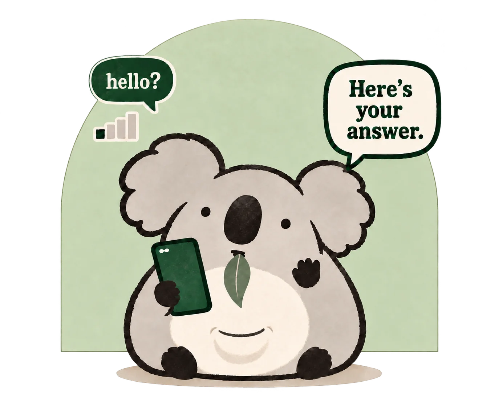

I'm a Buddhist Chaplain, Builder, and Biotech marketer. I bring chaplaincy into everyday life through [writing](/notes), [coaching](/hire/coaching), and creative projects that make room for reflection and practice.

I build things that put these interests into practice: from [Kuma](/kuma/), a gentle meditation timer, to [Debug Your Meditation](/projects/debug-your-meditation), a book about finding more joy in meditation.

My work also reaches into biotech. With a neuroscience PhD and a background in strategy and medical education, I help biotech companies connect with healthcare providers and patients. My research has spanned cancer imaging, multiple sclerosis, and the human genetics of sleep and circadian rhythms.

<a class="button" href="#projects">Explore my work ↗</a><a class="text-link" href="/hire">Work with me →</a>

<!-- home-intro-end -->

## Projects

  <article class="project-entry project-entry--featured">
    

Meditation &amp; everyday practice
<h3><a href="/kuma/">Kuma ↗</a></h3>
A meditation timer for iPhone, with an Apple Watch companion, gentle bells, a private practice history, and Home Screen widgets.
<a class="text-link" href="/kuma/">Meet Kuma →</a>

    
  </article>
  <article class="project-entry project-entry--featured">
    
<h3><a href="https://getgumleaf.com">GumLeaf ↗</a></h3>
Text any question, get a real answer back by SMS — even over satellite, off the grid. No app, no account. A service of <strong>Chong Consulting LLC</strong>. <a href="https://getgumleaf.com">getgumleaf.com</a>

    
  </article>
  <article class="project-entry"><h3><a href="/projects/ok-banger-show">OK Banger Show ↗</a></h3>
A live podcast about being a good person IRL, online, and onchain, co-hosted with Cameron Armstrong.
</article>
  <article class="project-entry"><h3><a href="/projects/reframe-science">Reframe Science ↗</a></h3>
A curated community for entrepreneurs and builders to study health like a compassionate scientist.
</article>
  <article class="project-entry"><h3><a href="/projects/debug-your-meditation">Debug Your Meditation ↗</a></h3>
A book that transforms meditation from a chore to “I want more!”
</article>

## Explore

  

    <h3><a href="/notes" class="internal-link">Notes</a></h3>
    
Thoughts, essays, and reflections on meditation, creative practice, and healthcare

  

  

    <h3><a href="/projects" class="internal-link">Projects</a></h3>
    
Check out Kuma, GumLeaf, Reframe Science, The OK Banger Show, and Debug Your Meditation

  

  

    <h3><a href="/hire" class="internal-link">Hire Me</a></h3>
    
Coaching on meditation, creative practice, and sustainable output

  

  

    <h3><a href="/about" class="internal-link">About</a></h3>
    
Learn more about my background, experience, and interests

  

  

    <h3><a href="/now" class="internal-link">Now</a></h3>
    
What I'm currently working on and thinking about

  

## Recent Notes


<ul class="note-list">

  <li><time datetime="{{ note.date | date: '%Y-%m-%d' }}">{{ note.date | date: "%b %-d, %Y" }}</time><a href="{{ note.url }}">{{ note.title }}</a></li>

</ul>

[View All Notes](/notes)

