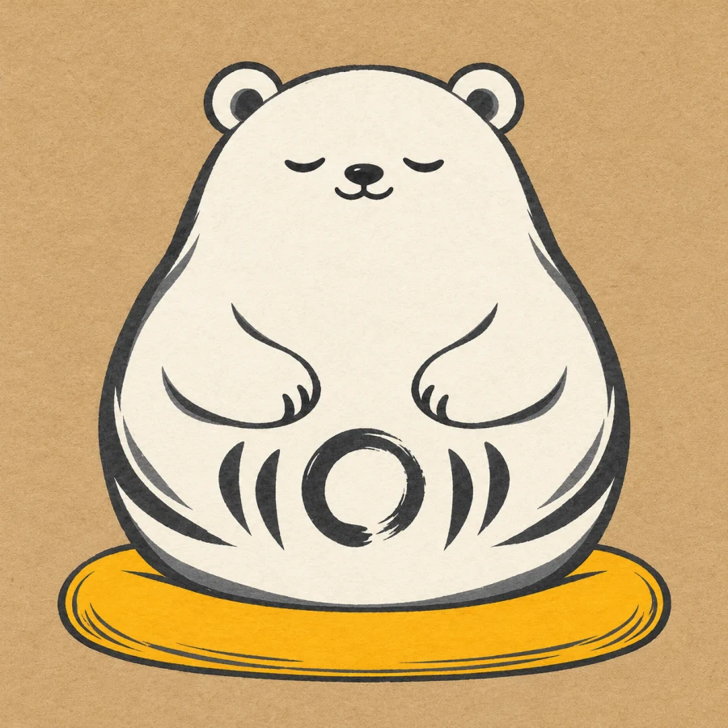

<section class="hero wrap">

A native meditation app for iPhone &amp; iPhone Duo
<h1>A little room for <em>being here.</em></h1>
Meet Kuma. A gentle meditation timer that helps you return to your own practice, one quiet moment at a time.
<a class="button" href="#beta">Let me know when it’s ready ↗</a>
Made for iPhone · Duo native · Beta coming soon

<figure class="hero-art"></figure>
</section>
<section id="practice" class="wrap section">

Less choosing. More being.
<h2>Your practice, at your pace.</h2>
For the moments when you already know what you need: a little quiet, a bell, and somewhere to begin.

<article>

01 / Settle in
<h3>A timer that leaves you room.</h3>
Choose your time and posture. Let the bell end your session, or keep going until you’re ready. Preparation and interval bells help you settle into your own rhythm.
</article>
<article>

02 / Return gently
<h3>Your practice, remembered.</h3>
Review your recent meditations, open a session’s details, and browse your full history. See your practice days and progress toward the aspirations you choose.
</article>
<article>

03 / Find your bearings
<h3>A little guidance, close by.</h3>
Open the illustrated, offline guide when you need a reminder. Read a teaching, take a reflection with you, and come back to your experience.
</article>

</section>

<section class="wrap section widget-section" id="widgets" aria-labelledby="widgets-title">
  

    
A little Kuma, right at home

    <h2 id="widgets-title">Your practice. A glance away.</h2>
    
A little surprise each time you glance. Kuma’s widgets bring a variety of delightful illustrations to your Home Screen, with gentle encouragement to return to practice.

  

  

    <figure class="widget-palette">
      <figcaption><h3>Sunshine</h3>
A little warmth for your Home Screen.
</figcaption>
      

        
        
      

    </figure>
    <figure class="widget-palette night">
      <figcaption><h3>Night Gold</h3>
A quiet glow against warm charcoal.
</figcaption>
      

        
        
      

    </figure>
  

  

    <article>
Your week, in pebbles
<h3>Small moments add up.</h3>
Each filled pebble marks a day you practiced in the past seven days. Choose an aspiration of one to seven days; even a short completed session counts.
</article>
    <article>
A bigger intention
<h3>See your time gather.</h3>
Set a total meditation-time aspiration and a quiet bar along the bottom shows your progress. Prefer a daily streak? Your widget can show that instead of weekly pebbles.
</article>
    <article>
A way back to quiet
<h3>Tap. Settle in.</h3>
Tap a widget to open Meditate. A compact Lock Screen widget keeps your rhythm or optional streak nearby, too, without needing to open your practice log.
</article>
  

</section>
<section class="health-section" id="apple-health" aria-labelledby="health-title">
  

    

      
Apple Watch + Apple Health

      <h2 id="health-title">A little quiet. Wherever you are.</h2>
      
Leave your phone aside and begin from your wrist. Choose your time with the Digital Crown, then let gentle haptics help you settle in and keep your practice close.

    

    

      <figure class="watch-example">

<figcaption><strong>A place to begin.</strong>Check your posture and duration, then tap Begin.</figcaption></figure>
      <figure class="watch-example">

<figcaption><strong>A moment to settle.</strong>Take a little time before your sit, or skip the countdown when you’re ready.</figcaption></figure>
      <figure class="watch-example">

<figcaption><strong>Stay with your moment.</strong>Your timer and controls stay close, so you can leave your phone aside.</figcaption></figure>

    

    

      <article>
Begin from your wrist
<h3>Put the phone down.</h3>
Start, pause, and finish a meditation on Apple Watch without your iPhone nearby. Gentle haptics mark your settling time, chosen duration, and intervals. Completed sessions join your iPhone history when the devices reconnect.
</article>
      <article>
Keep your practice together
<h3>A place for your quiet moments.</h3>
If you use Apple Health, you can choose to save completed meditations as Mindful Minutes. It’s a simple way to keep a record of the time you make for practice.
</article>
      <article>
Optional health reports
<h3>A little more insight.</h3>
If you’re curious, you can enable heart-rate reports from Apple Watch or step reports for walking meditations. Both are optional and separate from saving Mindful Minutes. Heart rate isn’t a measure of how well you meditated.

These reports stay on your devices and aren’t sent to Kuma’s cloud service or included in CSV exports. You control permissions in Apple Health. <a href="/kuma/privacy/">Read about Health and privacy.</a>
</article>
    

  

</section>
<section class="duo-section" id="duo" aria-labelledby="duo-title">
  

    

      
Duo native

      <h2 id="duo-title">A little more room. The same quiet practice.</h2>
      
Open Kuma on iPhone Duo and give your practice space to unfold. Kuma and your timer settle into separate panes that adapt as you open, fold, or rotate. Comfortably native to your iPhone Duo.

    

    

      <figure class="duo-card">

<figcaption>
Fully open
<h3>Room to settle in.</h3>
Kuma beside your timer, with posture, duration, and ending choices together.
</figcaption></figure>
      <figure class="duo-card">

Kuma<strong>You can begin again.</strong>

10:00MINUTES OF BEING HERE
SittingWalkingStandingLying down

10515
Begin
Meditate　 Log　 Guide　 Settings

<figcaption>
Half-open · tabletop
<h3>Set it down. Settle in.</h3>
The two panes stack around the fold when you rest Duo on a surface.
</figcaption></figure>
    

  

</section>
<section class="signup" id="beta">

A quiet invitation
<h2>Be here for the beginning.</h2>
Leave your email and we’ll let you know when Kuma’s public beta is ready to try.

For iPhone with iOS 18 or later.

<form name="kuma-beta" method="POST" action="/.netlify/functions/kuma-beta">
<label>Leave this empty <input name="bot-field" tabindex="-1" autocomplete="off"></label>
<label for="email">Your email address</label><input id="email" name="email" type="email" autocomplete="email" placeholder="you@example.com" maxlength="254" required aria-describedby="signup-privacy"><label class="consent"><input name="beta-consent" type="checkbox" value="yes" required>Email me about Kuma’s beta availability.</label><button class="button" type="submit">Save my place ↗</button>
Only Kuma beta updates. This won’t subscribe you to a newsletter. Unsubscribe anytime using the link in our emails. <a href="/kuma/privacy/#beta-waitlist">Waitlist privacy</a>.
</form>

</section>
<section class="wrap section faq" id="questions">

A few things to know
<h2>Before you settle in.</h2>

When can I try the beta?

The public TestFlight beta is being prepared. Join the email list above and we’ll send the installation details when external testing is available.

Does Kuma work on other iPhones?

Yes. Kuma supports iPhone with iOS 18 or later. The fold-aware Duo layout requires iOS 27.1 or later, but the meditation timer, personal practice log, offline written guide, and widgets are also available on supported compact iPhones.

Is Kuma a native meditation app for iPhone Duo?

Yes. Kuma is built with SwiftUI and includes fold-aware meditation and reflection layouts for iPhone Duo on iOS 27.1 or later. The timer and practice controls adapt to the inner display while compact iPhones keep a single-column layout. The public beta is in preparation.

Do I need an account or an Apple Watch?

Neither. Solo practice works without signing in. Cloud backup and Apple Health are optional, and you can use Kuma entirely on your iPhone. The optional Watch companion requires watchOS 11 or later.

How do I connect Apple Watch and Apple Health?

Install Kuma on your paired Apple Watch. In Kuma’s Settings → Apple Health, choose Save to Mindful Minutes, Heart rate reports, and Measure on Apple Watch as you prefer, then approve the relevant permissions. With Watch measurement enabled, starting a meditation on iPhone can launch recording on your nearby Watch. You can also begin directly on the Watch.

Requires iOS 18 or later and, for the Watch companion, watchOS 11 or later. Health readings may take time to sync and depend on available sensor data. Kuma shows recorded information; it does not interpret your heart rate medically or grade the quality of your meditation.

How do I add a Kuma widget?

Once you have Kuma installed, touch and hold your iPhone’s Home Screen, choose Edit → Add Widget, and search for Kuma. Pick a small or medium widget. In Kuma, open Settings → Widget appearance to choose Sunshine, Night Gold, or Match System. iOS controls when widgets refresh.

What kind of meditation is Kuma for?

Kuma supports self-directed practice with a flexible timer for sitting, walking, standing, or lying down. Choose a timed or open-ended session, set preparation and interval bells, and keep a personal practice log. The offline guide offers written teachings and reflections.

What if I miss a day?

Kuma starts with a flexible weekly aspiration, so you can build a rhythm that makes room for life. Any completed session counts as practice that day, including a short one. You can choose a strict daily streak in Settings if that’s helpful to you.

Who is Kuma?

Kuma is a quiet companion for your practice. His round, legless body recalls a Daruma doll, the Japanese figure inspired by Bodhidharma and associated with perseverance. His circular form also echoes the ensō of Zen brush painting—a simple expression of practice, presence, and space. (<a href="https://www.japan.travel/en/blog/try-your-luck-with-takasaki-daruma/">Daruma</a>, <a href="https://searchcollection.asianart.org/objects/19254/enso">Ensō</a>)

    
His white color is a nod to the <em>upāsaka</em>, a lay Buddhist practitioner. The Pāli Canon describes white-clad lay followers practicing amid everyday life. Kuma carries that spirit: a little company as you sit, return, and begin again. (<a href="https://suttacentral.net/dn29/en/sujato">DN 29</a>)

</section>
