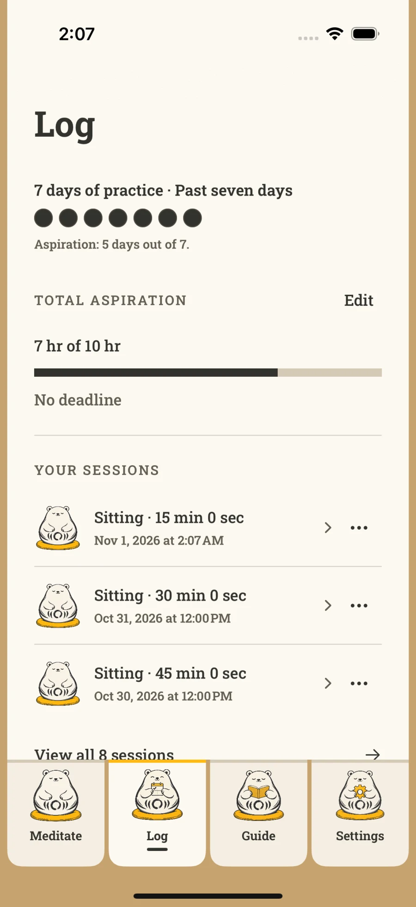

<section class="hero wrap">

A quiet companion for meditation
<h1>A little room for <em>being here.</em></h1>
Meet Kuma. A gentle meditation timer that helps you return to your own practice, one quiet moment at a time.
<a class="button" href="#beta">Let me know when it’s ready ↗</a>
Free meditation features · Made for iPhone · Beta coming soon

<figure class="hero-art"><figcaption>A small companion. A softer place to begin.</figcaption></figure>
</section>

You don’t have to make every day perfect. <strong>Just make a little space to return.</strong>
● ● ● ○ ● ○ ○

<section id="practice" class="wrap section">

Less choosing. More being.
<h2>Your practice, at your pace.</h2>
For the moments when you already know what you need: a little quiet, a bell, and somewhere to begin.

<article>

01 / Settle in
<h3>A timer that leaves you room.</h3>
Choose your time and posture. Let the bell end your session, or keep going until you’re ready. Preparation and interval bells help you settle into your own rhythm.
</article>
<article>

02 / Return gently
<h3>A rhythm you can live with.</h3>
Aspire to practice on one to seven days a week. Short sessions count. See your days gather as pebbles, with a personal log of the time you’ve made for yourself.
</article>
<article>

03 / Find your bearings
<h3>A little guidance, close by.</h3>
Open the illustrated, offline guide when you need a reminder. Read a teaching, take a reflection with you, and come back to your experience.
</article>

Real screens from the app in development. Details may change before release.

</section>
<section class="difference">

A different kind of meditation app
<h2>Come for the quiet. Stay for the bear.</h2>
Kuma is built around the simple act of showing up.

A library of guided meditations can be wonderful when you want someone to lead. Kuma offers a small, personal space for practicing on your own—with a companion who’s happy to see you return.

<article>01
<h3>Something to return to</h3>
Warm woodblock-inspired illustrations and Kuma’s changing expressions bring a little personality to an everyday ritual.

</article><article>02
<h3>Encouragement, on your terms</h3>
Flexible weekly aspirations are the starting point. Prefer a daily streak? That’s an option, too. Choose the reminders that fit your day.

</article><article>03
<h3>Your attention stays yours</h3>
Open the timer and begin. Solo practice needs no account, and all meditation features are free.

</article>

</section>
<section class="wrap section nearby">

A small reminder, right on your Home Screen.

Fits into your everyday
<h2>Keep a little quiet nearby.</h2>
Home Screen widgets keep Kuma within reach. The optional Apple Watch companion lets you start a meditation from your wrist.

Save Mindful Minutes to Apple Health if you choose. Keep your session history close, and export it whenever you want a copy of your own.
<a class="text-link" href="/kuma/privacy/">Your practice, your choices ↗</a>
</section>
<section class="signup" id="beta">

A quiet invitation
<h2>Be here for the beginning.</h2>
Leave your email and we’ll let you know when Kuma’s public beta is ready to try.

For iPhone with iOS 18 or later. No release date yet. We’ll write when it’s ready.

<form name="kuma-beta" method="POST" action="/kuma/thanks/" data-netlify="true" netlify-honeypot="bot-field"><input type="hidden" name="form-name" value="kuma-beta">
<label>Leave this empty <input name="bot-field" tabindex="-1" autocomplete="off"></label>
<label for="email">Your email address</label><input id="email" name="email" type="email" autocomplete="email" placeholder="you@example.com" maxlength="254" required aria-describedby="signup-privacy"><label class="consent"><input name="beta-consent" type="checkbox" value="yes" required>Email me about Kuma’s beta availability.</label><button class="button" type="submit">Save my place ↗</button>
Only Kuma beta updates. This won’t subscribe you to a newsletter. Your email is stored securely through Netlify Forms. To leave the list, email <a href="mailto:hi@christinchong.com?subject=Remove%20me%20from%20the%20Kuma%20beta%20list">hi@christinchong.com</a>. <a href="/kuma/privacy/#beta-waitlist">Waitlist privacy</a>.
</form>

</section>
<section class="wrap section faq" id="questions">

A few things to know
<h2>Before you settle in.</h2>

Is Kuma free?

Yes. All meditation features are free. Optional support for Christin’s work does not unlock features.

How is Kuma different from apps like Insight Timer?

If you want a wide library of guided sessions, an app like <a href="https://insighttimer.com/">Insight Timer</a> may suit you. Kuma focuses on self-directed practice: a flexible timer, an illustrated companion, a weekly rhythm, and your personal log. Its offline guide offers written teachings and reflections rather than an audio catalog.

Do I need an account or an Apple Watch?

Neither. Solo practice works without signing in. Cloud backup and Apple Health are optional, and you can use Kuma entirely on your iPhone. The optional Watch companion requires watchOS 11 or later.

When can I try the beta?

The public TestFlight beta is being prepared. Join the email list above and we’ll send the installation details when external testing is available. Signing up does not install the app or guarantee a release date.

What if I miss a day?

Kuma starts with a flexible weekly aspiration, so you can build a rhythm that makes room for life. Any completed session counts as practice that day, including a short one. You can choose a strict daily streak in Settings if that’s helpful to you.

</section>
