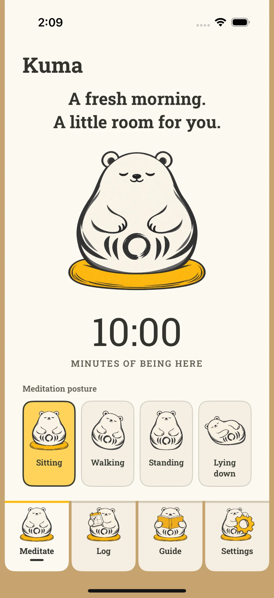
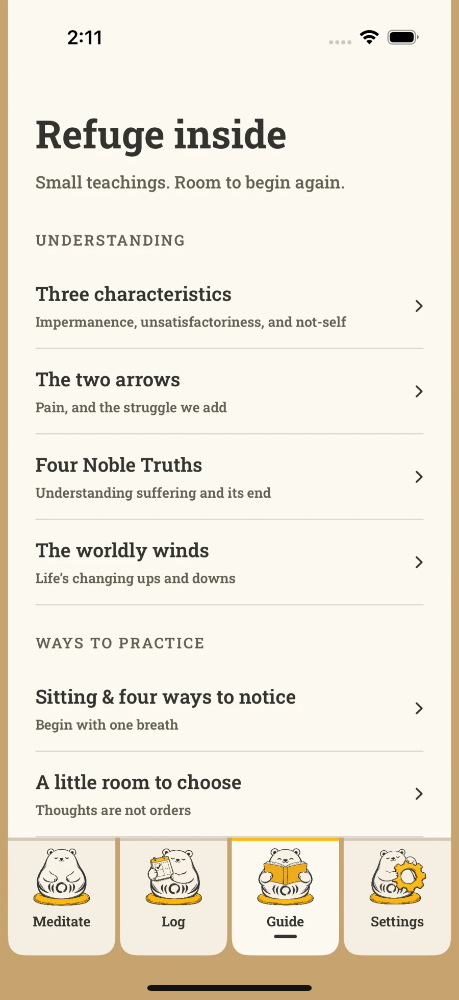
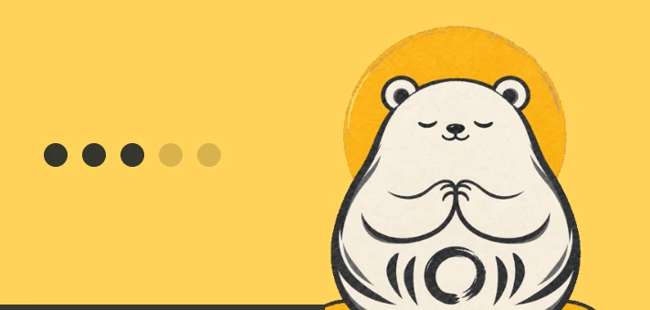
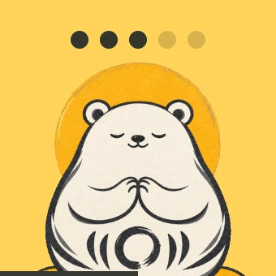
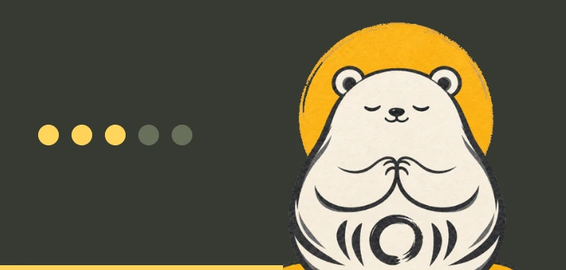
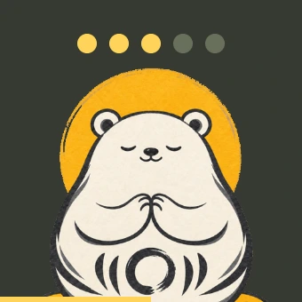
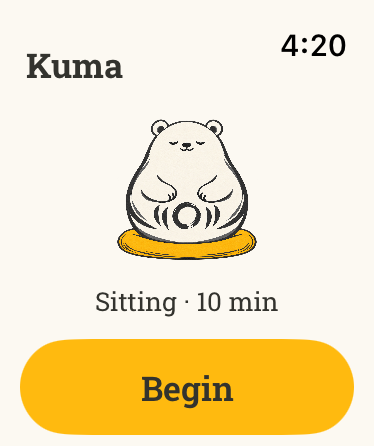
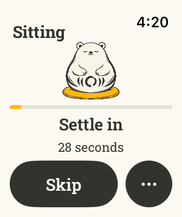
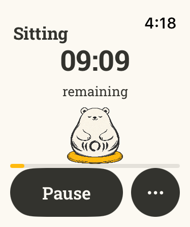

<section class="hero wrap">

A meditation timer for iPhone
<h1>A little room for <em>being here.</em></h1>
Meet Kuma. A meditation timer and a little company for your practice. Choose your time, find a comfortable position, and begin wherever you are today.
<a class="button" href="#beta">Try Kuma ↗</a>
An early version is available now through TestFlight, Apple’s app for trying new apps.

<figure class="hero-art"></figure>
</section>
<section id="practice" class="wrap section">

Less choosing. More being.
<h2>Your practice, at your pace.</h2>
Some days you have time for a longer meditation. Other days, a few minutes is what you have. Choose what works for you today.

<article>

01 / Settle in
<h3>A timer for the way you practice.</h3>
Sit, walk, stand, or lie down. Set a timer, or leave the ending open. You can add a few moments to settle in before you begin, and bells along the way.
</article>
<article>

02 / Return gently
<h3>A way to look back.</h3>
See your past meditations and the days you’ve practiced. If you’d like something to work toward, choose an aspiration: how often you’d like to meditate, or how much time you’d like to give it.
</article>
<article>

03 / Find your bearings
<h3>Something to explore.</h3>
Browse the illustrated guide for teachings and reflections to bring into your practice. Keep something useful in mind, try it, and notice what happens. The guide works without an internet connection.
</article>

</section>

<section class="wrap section widget-section" id="widgets" aria-labelledby="widgets-title">
  

    
A little Kuma, right at home

    <h2 id="widgets-title">A little company on your Home Screen.</h2>
    
Kuma’s widgets show your recent practice alongside a changing collection of illustrations. Tap one when you’re ready to meditate.

  

  

    <figure class="widget-palette">
      <figcaption><h3>Sunshine</h3>
A little warmth for your Home Screen.
</figcaption>
      

        
        
      

    </figure>
    <figure class="widget-palette night">
      <figcaption><h3>Night Gold</h3>
A quiet glow against warm charcoal.
</figcaption>
      

        
        
      

    </figure>
  

  

    <article>
Your week, in pebbles
<h3>Little by little.</h3>
Each filled pebble marks a day you meditated in the past week. Choose how many days you’d like to practice. A short meditation counts, too.
</article>
    <article>
Your aspirations
<h3>Something to work toward.</h3>
Choose an aspiration for your total meditation time and see your progress. If you enjoy keeping a daily streak, you can show that instead.
</article>
    <article>
Ready when you are
<h3>Tap to begin.</h3>
Tap a widget to open your timer. You can also add a small widget to your Lock Screen to see your recent practice or daily streak.
</article>
  

</section>
<section class="community-section" id="community" aria-labelledby="community-title">
  

    

      
A little encouragement

      <h2 id="community-title">Your own practice. A little company.</h2>
      
Some days, knowing someone else is making time to meditate can help you find your way back. Kuma’s community is a place to find that quiet encouragement, and offer a little of your own.

    

    <figure class="community-animals">
      <ul class="animal-gallery" aria-label="A few of the community animals">
        <li>Bear</li>
        <li>Koala</li>
        <li>Cat</li>
        <li>Dog</li>
        <li>Frog</li>
        <li>Capybara</li>
      </ul>
      <figcaption>55 little faces to choose from. Find an animal that feels like you.</figcaption>
    </figure>
    

      <article><h3>A reminder to return.</h3>
See others who have meditated in Kuma. You each practice in your own time, with a shared intention to keep making room for it.
</article>
      <article><h3>A little personality.</h3>
Choose a community name and a cute animal avatar, from Bear to Capybara. A familiar little face for your place in the community.
</article>
      <article><h3>Share only a little.</h3>
Members see your chosen name, animal, and that you’ve meditated in Kuma. Your session times, durations, reflections, and Health data stay private.
</article>
    

    

When you’re ready, open <strong>Community</strong> from Log or Settings in Kuma. Sign in with Apple, choose your name and animal, and join. After your first meditation, you can see other members and appear alongside them.

Joining is optional, and you can leave anytime. This is a community of people who have practiced, rather than a live group session.
<a class="text-link" href="#beta">Try Kuma and find your little face ↗</a>

  

</section>
<section class="health-section" id="apple-health" aria-labelledby="health-title">
  

    

      
Apple Watch + Apple Health

      <h2 id="health-title">Leave your phone aside.</h2>
      
Start a meditation on Apple Watch. Choose your time using the dial, then let gentle taps on your wrist mark the beginning, intervals, and end.

    

    

      <figure class="watch-example">

<figcaption><strong>A place to begin.</strong>Choose how you’ll meditate and for how long, then tap Begin.</figcaption></figure>
      <figure class="watch-example">

<figcaption><strong>A moment to settle.</strong>Take a moment before you begin, or skip the countdown when you’re ready.</figcaption></figure>
      <figure class="watch-example">

<figcaption><strong>Your timer, close by.</strong>Pause or finish your meditation from your wrist.</figcaption></figure>

    

    

      <article>
Begin from your wrist
<h3>Practice from your wrist.</h3>
Start, pause, and finish a meditation on Apple Watch without your iPhone nearby. Your completed meditations appear in your iPhone history when the devices reconnect.
</article>
      <article>
Keep your practice together
<h3>Keep a record in Apple Health.</h3>
If you’d like, Kuma can save your meditation time to Apple Health as Mindful Minutes.
</article>
      <article>
Optional health reports
<h3>Curious about heart rate or walking steps?</h3>
Optional reports let you look at readings recorded during your meditation. Your heart rate doesn’t tell you how well you practiced. These reports are separate from saving Mindful Minutes.

These reports stay on your devices. They aren’t sent to Kuma’s online backup service or included when you download your meditation history. You choose what Kuma can access in Apple Health. <a href="/kuma/privacy/">Read about Health and privacy.</a>
</article>
    

  

</section>
<section class="duo-section" id="duo" aria-labelledby="duo-title">
  

    

      
iPhone Duo

      <h2 id="duo-title">A little more room on iPhone Duo.</h2>
      
Open your iPhone Duo to see Kuma beside your timer. Rest it half-open on a table, and the timer controls move below Kuma. The layout adjusts as you fold or turn your phone.

    

    

      <figure class="duo-card">

<figcaption>
Fully open
<h3>Room to settle in.</h3>
See Kuma beside your timer, with your meditation settings close by.
</figcaption></figure>
      <figure class="duo-card">

Kuma<strong>You can begin again.</strong>

10:00MINUTES OF BEING HERE
SittingWalkingStandingLying down

10515
Begin
Meditate　 Log　 Guide　 Settings

<figcaption>
Half-open · tabletop
<h3>Set it down. Settle in.</h3>
Rest your phone half-open on a table, with Kuma above your timer controls.
</figcaption></figure>
    

  

</section>
<section class="signup" id="beta">

You’re invited
<h2>Come try Kuma.</h2>
Kuma is ready for you to try. Enter your email and we’ll send you a link, with a few steps to get started on your iPhone.

This is an early version, so you may run into things that need fixing. I’d love to hear how it works for you.

Kuma currently uses TestFlight, Apple’s free app for trying apps before they’re released. Requires iOS 18 or later.

<form name="kuma-beta" method="POST" action="/.netlify/functions/kuma-beta">
<label>Leave this empty <input name="bot-field" tabindex="-1" autocomplete="off"></label>
<label for="email">Your email address</label><input id="email" name="email" type="email" autocomplete="email" placeholder="you@example.com" maxlength="254" required aria-describedby="signup-privacy"><label class="consent"><input name="beta-consent" type="checkbox" value="yes" required>Email me the link to try Kuma and occasional updates while the app is being tested.</label><button class="button" type="submit">Email me the link ↗</button>
This signs you up for Kuma emails, separate from my newsletter. Unsubscribe anytime. <a href="/kuma/privacy/#beta-waitlist">Privacy policy</a>.
</form>

</section>
<section class="wrap section faq" id="questions">

A few things to know
<h2>Common questions.</h2>

How do I try Kuma?

You can try Kuma now through TestFlight, Apple’s free app for trying apps before they’re released. Enter your email above and we’ll send you a link, with a few steps to get started on your iPhone.

Will Kuma work on my iPhone?

Kuma works on iPhones running iOS 18 or later. The special iPhone Duo layouts need iOS 27.1 or later. You can use the timer, practice history, written guide, and widgets on other supported iPhones, too.

Does Kuma work on iPhone Duo?

Yes. Kuma adjusts as you open, fold, or turn your iPhone Duo. When fully open, Kuma sits beside your timer. When half-open on a table, Kuma appears above the timer controls. These layouts need iOS 27.1 or later.

Do I need an account or an Apple Watch?

No. You can meditate on your iPhone without signing in. Apple Watch, cloud backup, and Apple Health are optional. The Watch app needs watchOS 11 or later.

How do I use Kuma on Apple Watch?
<ol><li>Install Kuma on the Apple Watch paired with your iPhone.</li><li>Open Kuma on your Watch and choose how you’ll meditate and for how long.</li><li>Tap Begin. You can pause or finish from your Watch, too.</li></ol>
Your Watch needs watchOS 11 or later. Completed meditations appear in your iPhone history when the devices reconnect.

How do I use Kuma with Apple Health?
<ol><li>In Kuma, open Settings → Apple Health.</li><li>Choose Save to Mindful Minutes if you’d like to record your meditation time in Apple Health.</li><li>For optional heart-rate readings, turn on Heart rate reports and Measure on Apple Watch, then allow the access Apple asks for.</li></ol>
With Watch measurement enabled, beginning a meditation on your iPhone can start recording on your nearby Watch. Readings may take time to appear and depend on what your devices record. Heart rate doesn’t tell you how well you meditated, and Kuma doesn’t assess it for medical purposes.

How do I add a Kuma widget?

A widget is a small view of Kuma that lives on your Home Screen.
<ol><li>Touch and hold your iPhone’s Home Screen.</li><li>Choose Edit → Add Widget and search for Kuma.</li><li>Pick a small or medium widget.</li></ol>
To change its colors, open Kuma’s Settings → Widget appearance and choose Sunshine, Night Gold, or Match System. Your iPhone decides when widgets update, so changes may take a little time to appear.

How does Kuma’s community work?

Open Community from Log or Settings, sign in with Apple, and choose a community name and one of 55 animal avatars. Joining is optional; signing in alone doesn’t make you visible. After you have joined and meditated, you can see other members who have meditated in Kuma at any time. This isn’t a live group session. Members see your chosen name, animal, and that you’ve meditated; your session times, durations, reflections, and Health data stay private. You can leave anytime.

What kind of meditation is Kuma for?

Kuma gives you a timer for practicing on your own, whether you’re sitting, walking, standing, or lying down. There’s also a written guide with teachings and reflections to explore. The guide works without an internet connection.

What if I miss a day?

Then you can practice again when you’re able. You can choose a weekly aspiration that fits your life, and change it as your circumstances change. Even a short meditation counts. If you enjoy keeping a daily streak, you can choose that in Settings.

Who is Kuma?

Kuma is the bear keeping you company as you practice. His round, legless shape is inspired by Japanese Daruma dolls, traditionally associated with perseverance.
<h3>The inspiration behind Kuma</h3>
Daruma dolls are inspired by Bodhidharma, a Buddhist teacher. The circle on Kuma’s belly echoes the <em>ensō</em>, a circle painted with a brush in Zen art. His white color is a nod to the <em>upāsaka</em>, a lay Buddhist practitioner. The Pāli Canon describes white-clad lay followers practicing amid everyday life.

Explore the inspirations: <a href="https://www.japan.travel/en/blog/try-your-luck-with-takasaki-daruma/">Daruma dolls</a>, <a href="https://searchcollection.asianart.org/objects/19254/enso">the ensō in Zen art</a>, and <a href="https://suttacentral.net/dn29/en/sujato">lay followers in the Pāli Canon</a>.

</section>
